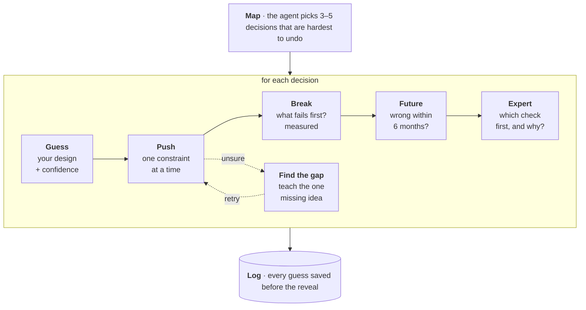

# Inquiry Engine

**Understand the code your AI agents wrote.**

[](LICENSE) &nbsp;Free · no account · no key · no telemetry

Agents can build a whole project in days. You approve the work, but you did not make the design decisions. A month later you cannot say why it is built this way, what breaks first, or what to change next.

Type **`learn`** in any project. The agent stops explaining and starts asking. You guess each design decision first. Then the code, or a real measurement, shows you the answer.

---

## Quick start

```bash
git clone https://github.com/gentritr1/inquiry-engine
```

```bash
ln -s "$PWD/inquiry-engine/skills/learn" ~/.claude/skills/learn
```

Open any project in Claude Code and type `learn`. Other agents that read skill folders work too: link the folder into their skills directory.

---

## Why

| What usually happens | Why it fails |
|---|---|
| The agent explains its work | An explanation feels like learning. A week later you cannot rebuild the idea alone. |
| You read the agent's summary | It says what was built, not what was traded away. |
| "It works" on a quiet day | It says nothing about the day traffic doubles or a service goes down. |
| Nobody writes down your first guess | So you never find out how often you are wrong. |

---

## How it works



- **The code is the answer key.** The agent reads the code and its git history, not its own summaries.
- **Reality settles arguments.** A simulation or the project's own tests measure what breaks. If nothing can measure it, the agent says "not measured".
- **When you are unsure,** the agent does not repeat the answer louder. It finds the missing idea underneath, teaches that one idea, and lets you try a new case alone.
- **Plain English, real terms.** Short sentences, one new idea at a time. You still get the technical term, in bold, because you need it to work with other engineers.
- **Next session** opens with one review question, answered from memory.

---

## What a session looks like

From a test run on the open-source [breakscale](https://github.com/workersio/breakscale) repo. The agent's lines are real output. The test wrote the owner's lines.

> **Agent:** A student draws some servers and a database, and the lines between them. Each box has two settings: how many requests it can work on at once, and how long one takes. The student drags the traffic up. The tool must show how slow the slowest 1 in 100 requests is, and how many fail. How would you solve it, and how sure are you, 50 to 99%?
>
> **Owner:** I'd calculate it. Arrivals divided by capacity, then a waiting-line formula for latency. 80% sure.
>
> **Agent:** Logged at 80%. For one box alone that holds. Next constraint: a caller gives up after a set time and asks again. Now the load depends on the failures, and the failures depend on the load. How would you change it?

<details>
<summary><b>When the owner is unsure: finding the gap</b></summary>

<br/>

From a second test run. The agent's lines are shortened.

> **Owner:** If the box can do 100 a second and only 80 come, every request goes straight in. So no line.
>
> **Agent:** Now I change one detail. The 80 still come in one second, but 20 arrive at the same moment. What happens to those 20?
>
> **Owner:** Still no line. 80 is less than 100.
>
> **Agent:** At that moment, 20 requests want 10 places. 10 go in, and 10 wait. Think of a shop with 10 tills when a bus brings 20 people. Your rule is true for the whole second. It says nothing about a single moment. Engineers call this average fullness **utilization**. Why did 10 requests wait when utilization was only 80%?

</details>

### With and without the skill

| | Plain agent | With `learn` |
|---|---|---|
| First reply to "learn" | A full tour of the project | One question about the problem |
| Asks for your guess | No | Yes, with a confidence |
| Logs what you believed | No | Before every reveal |
| What breaks first | Its opinion | A measured run, or "not measured" |

---

## Where your data goes

- **Session notes** stay in the project, in `.learn/`, kept out of git.
- **Your guesses** go to `logs/predictions.jsonl` in your copy of this repo. Append-only.
- **Load and failure questions** can use the [breakscale](https://github.com/workersio/breakscale) simulator if you connect it. The skill works without it.

---

## The goal

People who can explain, defend and improve the systems their agents build.

The prediction log is the proof: your guesses, how sure you were, and what was real. If the log shows the sessions do not teach, the skill is retired. The rule is written in [`analysis/05_learn_loop.md`](analysis/05_learn_loop.md).

## Honest status

**Not yet proven.** The skill was tested on agents: three scenarios with it, one without, one run each, on one repo. That shows an agent follows it. It does not show that a person learns from it. Only filled logs can show that. The first 20 logged guesses are the baseline.

---

## The method, in five lines

1. **Spine.** Say what you want in one sentence, name the one thing in the way, and find the cheapest test that could change your mind.
2. **Predict before reveal.** Write your answer and confidence *before* you ask the AI. Learning lives in the gap.
3. **Let reality veto.** An idea is worth what it predicts. Elegance is a warning, not a proof.
4. **Rigor is a budget.** Spend it by stakes × irreversibility.
5. **Amendment rule.** The rules change only after real, logged failures.

## Where it came from

The method came from a 102-day ChatGPT thread (*Project Planning with LLM*, 1 Jul – 11 Oct 2026) that started with one question: *how do I get a very smart LLM to plan a project too complex to hold without the plan?* It became a Discovery Engine, *The Book of Inquiry* (v1 → v3), an Operating Card and Inquiry Logs.

The `learn` skill also takes lessons from two MIT-licensed projects:

- [EricJujianZou/rederive](https://github.com/EricJujianZou/rederive): re-derive each decision from the bare problem; the decision map.
- [workersio/breakscale](https://github.com/workersio/breakscale): load a design until it breaks; show only measured numbers.

What was taken and changed is in [`analysis/05_learn_loop.md`](analysis/05_learn_loop.md).

<details>
<summary><b>What's in this repo</b></summary>

<br/>

| Path | What it holds |
|---|---|
| `skills/learn/SKILL.md` | The `learn` skill |
| `logs/predictions.jsonl` | Append-only prediction log (created on first use) |
| `analysis/05_learn_loop.md` | Design note, lessons taken, test runs, review and kill rule |
| `TIMELINE.md` | Every file of the thread, in order |
| `sources/1-…` to `sources/5-…` | Each phase: transcript and every attached or generated file |
| `analysis/00_snaxx_context.md` | Who we are and what we asked for |
| `analysis/01_extraction.*` | Arc, core ideas, frameworks, prompts, lessons, weak spots, verdict |
| `analysis/02_application.*` | Methodology, products, tests, 30-day plan |
| `site/build.py` → `site/dist/` | The site built from `analysis/*.json`. Rebuild: `python3 -I site/build.py` |
| `raw/` *(git-ignored)* | The full ChatGPT export, verified by SHA-256 |

**Provenance:** exported 13 Oct 2026 through the owner's signed-in ChatGPT session. Transcript and text files match the page's own SHA-256 hashes. A secret scan found no credentials.

**To change the method:** point to a logged failure, not to a version that reads better.

</details>

## License

[MIT](LICENSE). Use it, change it and share it for free.
